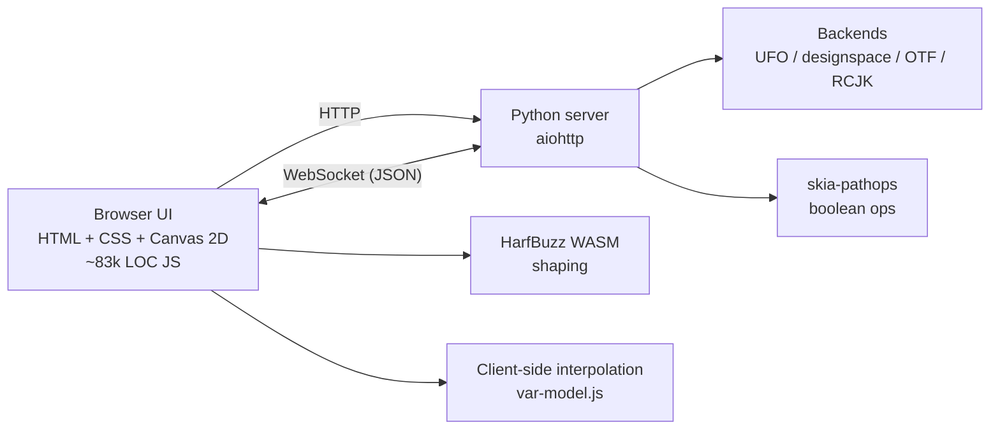

# Fontra Going Desktop — Architecture Brainstorm & Recommendation

**Date:** 2026-11-21
**Status:** Brainstorm / decision input (no code changes)
**Question:** Should Fontra leave the browser and become a desktop application — embedded webview, Python + HTMX, Rust native, or something else — and what would it take to match Glyphs-class performance, functionality, and stability?

---

## 0. Verdict first

1. **Do not rewrite the editor UI in Rust now.** Fontra's client is ~83k lines of working, tested UI. A native rewrite is a 3–5 year detour before feature parity with *today's* Fontra, and 8+ years before Glyphs-level depth. Rust is the right language for the geometry core, not (yet) for the shell.
2. **Do ship a native shell around the existing web core.** The single highest-value desktop change is replacing `webbrowser.open()` with an embedded WebView window. That buys native menus, file dialogs, drag-and-drop, single-instance behavior, and a lifecycle you control — which is what makes autosave and crash recovery practical. It is a matter of weeks, not years.
3. **Do not use HTMX for the editor.** HTMX moves state and rendering to the server. A glyph editor needs the opposite: local-first state and an 8–16 ms feedback loop. HTMX is fine for settings/metadata pages, but it cannot drive a canvas.
4. **Do move hot geometry into Rust/WASM, one module at a time, behind benchmarks.** Boolean ops, interpolation, offsetting, hit testing, and curve fitting are where compiled code compounds. This can be adopted incrementally and is also useful in browser mode.
5. **Treat "desktop" as an integration and distribution project, not a performance project.** The frame-time problems are local-first interaction, redundant work, JSON round trips, and general-purpose canvas drawing. None of those are fixed by merely leaving the browser.

**Recommended stack:** Python host + embedded WebView (pywebview first, Tauri if packaging/updater demands grow) + the existing JS/Canvas UI + a Rust/WASM geometry core, with the browser mode kept as a first-class deployment for collaboration and remote work.

**Expected outcome:** most of the perceived "native app" gap closed in 2–3 months (estimate), and a credible path to Glyphs-class interaction performance without discarding the 83k-line UI or the multi-user architecture.

---

## 1. The three questions hidden inside "go desktop"

"Desktop" is used to mean three different things. They have different costs and different fixes, and conflating them is how projects choose the wrong stack.

| Question | What it actually changes | What it does **not** change |
|---|---|---|
| **Window & packaging** | App icon, menus, shortcuts, file dialogs, drag-and-drop, recent files, auto-update, crash recovery, single instance, OS integration | Frame time, geometry speed, rendering quality |
| **Rendering & geometry** | Drag latency, large-font handling, boolean ops, text preview, glyph grid, memory | Menus, installers, file dialogs |
| **Feature depth** | Hinting, color fonts, smart components, OpenType layout UI, scripting, plugin ecosystem | The language or shell you choose |

A native shell answers (1). A Rust core answers (2). Neither answers (3) — features are years of product work regardless of stack.

Fontra's weak point today is mostly (1), partly (2), and not at all solved by changing (3)'s runtime.

---

## 2. The benchmark: what Glyphs, FontCreator, and FontLab actually are

| App | Stack | Platform | Age | Plugin model | Why it feels fast |
|---|---|---|---|---|---|
| **Glyphs 3/4** | Native macOS, Cocoa / Objective-C | macOS only | Since 2011 (~15 years) | Python + Objective-C SDK, large ecosystem | Single native process, native event loop and drawing, no IPC on the hot path, 15 years of workflow-specific optimization |
| **FontCreator** | Delphi / Object Pascal; VCL on Windows, FireMonkey on macOS | Windows + macOS (Mac port shipped 2024) | Since the late 1990s (~25+ years) | Limited; Windows-focused | Compiled native code, direct canvas drawing, 25 years of edge cases; the Mac port took ~2 years and reached ~98% feature parity |
| **FontLab 9** | C++ with Qt, `fontgate` engine, PythonQt | macOS + Windows | 30 years of lineage | Python 3 + PythonQt, TypeRig, large script ecosystem | Compiled geometry engine, native Qt UI, Python only at the edges, decades of optimization |

Three observations that matter for the decision:

- **All three are native, single-process, compiled applications.** None of them puts a network protocol between the pointer and the outline.
- **Their moat is time, not toolkit.** FontCreator needed ~2 years to port 25 years of Windows behavior to macOS. FontLab's engine predates the modern web. Glyphs is macOS-only and has been refined for 15 years.
- **Their plugin ecosystems are Python-first where they exist.** Glyphs and FontLab both have large Python scripting communities; FontCreator relies more on built-in features. Any Fontra rewrite must preserve a scripting path (Python or JS), or it loses a core audience.

"Matching Glyphs" therefore means matching a moving target with a 15-year head start. The stack choice can close the *performance* gap; it cannot shortcut the *feature and polish* gap.

---

## 3. Fontra today, by the numbers

Measured from this repository (branch `code-review-feedback-42427`, 2026-11-21):

| Metric | Value |
|---|---|
| Client JavaScript | ~83,200 lines across 7 workspaces |
| Python server/core | ~13,900 lines |
| Production JS bundle | ~1.9 MB across 17 files (largest: `fontra-core` 562 KB, `views-editor` 460 KB) |
| Rendering | HTML5 **Canvas 2D**, with `Path2D` caching per static glyph |
| Shaping | **HarfBuzz compiled to WASM** (`harfbuzzjs`) |
| Font parsing in client | `lib-font`, `fflate` |
| Transport | WebSocket (JSON) for the editing session; HTTP `/api/{function}` for calls |
| Backends | UFO, designspace, OTF/TTF/TTX/WOFF, RCJK (RoboCJK), custom Python backends |
| Tests | 654 pytest, 171 local-plugin tests, Mocha suites in `src-js` |
| Desktop packaging | PyInstaller (`fontra-pak`), starts an `aiohttp` server, opens the **system browser** |
| License | GPLv3 |

### Current architecture

### Strengths to preserve

- **Local-first interaction already exists.** Dragging sends throttled `editIncremental` messages and commits with `editFinal`; rendering, hit testing, selection, undo, and interpolation are client-side. The hot path does *not* wait on Python.
- **Real engineering foundations.** `Path2D` caching, intersection-observer-based glyph cells, client-side variable-font model, WASM shaping, incremental edit protocol, and a large test suite.
- **Backend flexibility.** Python backends for UFO/designspace/OTF/RCJK are a genuine differentiator; Glyphs and FontLab are more closed.
- **Multi-user and remote are architectural, not bolted on.** The WebSocket + server model enables collaboration and remote/cloud editing that a local-only native app would have to reinvent.
- **Cross-platform by construction.** One UI for Windows, macOS, Linux, and any browser.

### Structural gaps vs. a native editor

| Area | Gap | Severity |
|---|---|---|
| Window integration | Opens in a browser tab; no native menus, file dialogs, recent files, drag-and-drop from Explorer/Finder, single instance | High (perceived quality) |
| Lifecycle | Closing the tab ends the session; no autosave/recovery story at the OS level | High (trust) |
| Rendering ceiling | Canvas 2D is general-purpose; 65k-glyph grids and long text runs need a GPU/atlas approach for 120 Hz | Medium |
| Geometry | Boolean ops and some batch work cross into Python; JSON serialization on large paths | Medium |
| Feature depth | No hinting UI, no first-class color-font layers, no smart components/bracket-layer equivalent, less mature OT-layout UI | High (but product work, not stack work) |
| Scripting/plugins | JS plugin API is young; no designer-facing Python console equivalent to Glyphs/FontLab | Medium–High (ecosystem) |
| OS integration | No font install/preview, no Quick Look/Explorer preview, no system services | Medium |
| Engine consistency | Users may run Chrome, Edge, Safari, Firefox — different Canvas/WebGL behavior | Medium (a shell fixes it) |

---

## 4. Where the milliseconds actually go

A 60 Hz frame is **16.7 ms**; a 120 Hz frame is **8.3 ms**. Anything that blocks the main thread longer than ~50 ms is perceived as a hitch.

| Hot path | Where it runs today | Typical cost | What actually fixes it |
|---|---|---|---|
| Pointer move → hit test → selection → redraw | JS, client | 1–8 ms for a normal glyph; grows with point count and scene complexity | Spatial index, dirty rectangles, cached `Path2D`, avoiding full-scene rebuilds |
| Glyph switch | WebSocket fetch → JSON parse → instantiate → build path → draw | 10–80 ms first view, <16 ms cached | Prefetch neighbors, binary encoding, keep parsed glyphs in an LRU |
| Drag with incremental edits | JS + throttled WebSocket sends | Usually fine; risk is awaiting the server per move | Local-first edits + async persistence (already partly done) |
| Boolean op (remove overlap, etc.) | Python + `skia-pathops`, round trip | 20–200+ ms depending on path complexity | Move to WASM/worker; avoid serialization; cache results |
| Text preview | HarfBuzz WASM + Canvas 2D | Shaping is fast; drawing many glyphs per frame is the cost | Glyph atlas / WebGL or WebGPU renderer, run caching |
| Glyph grid (65k glyphs) | DOM cells + IntersectionObserver | Layout/paint cost grows with cell count and scroll speed | Virtualized canvas grid or GPU atlas; DOM only for chrome |
| Font open | Python parse + glyph map transfer | 0.3–3 s depending on format and size | Background parse, streaming glyph map, progress UI |
| Save | Python + backend write | 0.2–2 s+ | Background/atomic save, incremental writes, never block the UI |

**Conclusion:** most of the perceived slowness in a font editor comes from (a) redundant work, (b) synchronous main-thread work, (c) round trips, and (d) drawing very large scenes with a general-purpose renderer. All four are fixable *inside the current architecture*. Changing the language fixes only part of (d) and almost none of (a)–(c).

This is why "go desktop" alone will not make Fontra feel like Glyphs. It will make it *feel like an app*, which is valuable but different.

---

## 5. Option A — Stay in the browser (status quo, hardened)

**What it is:** keep the current server + browser model; invest in performance and UX polish.

**Gains:** zero migration cost; keeps collaboration, remote editing, zero-install; one codebase; fastest feature velocity.

**Costs:** browser-tab lifecycle remains; engine variance remains; native integration remains limited; users must understand "start the server, then open the browser".

**Verdict:** necessary baseline, not sufficient for a "pro desktop app" story. Keep it as a supported mode, not the only mode.

**Score (12-month): 4.0 / 5** — cheap and safe, but leaves the desktop gap open.

---

## 6. Option B — Put a browser inside (the pragmatic desktop)

This is the "integrate something like a browser inside" idea. It is the highest ROI change available.

### B1. pywebview (recommended first step)

A thin Python wrapper around the OS webview: **WebView2 (Chromium)** on Windows, **WKWebView** on macOS, **GTK/Qt WebKit** on Linux. It runs in the same Python process as the existing server, so the delta from Fontra Pak is small.

- **Effort:** days for a prototype, 2–6 weeks for a polished shell.
- **Gains:** native window, app icon, menus, file dialogs, drag-and-drop, single instance, no browser tab, no "open your browser" step.
- **Limits:** updater, installer, crash reporting, and deep OS integration are DIY; Linux WebKit can be dated; not a full app framework.
- **Fit:** excellent for this codebase, because the host is already Python and PyInstaller.

### B2. Tauri v2

Rust shell + system webview. **WebView2 (Chromium)** on Windows, **WKWebView** on macOS, **WebKitGTK** on Linux. Good updater and bundler, native menus/tray/dialogs.

- **Effort:** 1–3 months for a production shell, plus Python sidecar packaging.
- **Gains:** best shell-size/quality tradeoff (the Tauri shell itself is ~1 MB vs Electron's ~100 MB; your bundled Python runtime dominates both); strong updater and signing story; Rust host can also host native geometry later.
- **Limits:** three engine families to test; Python must be bundled as a sidecar; more moving parts than pywebview.
- **Fit:** the natural upgrade if the desktop app becomes a product with updates and installers.

### B3. Electron

Bundled Chromium + Node. **Consistent engine everywhere**, best devtools, mature auto-update, native menus/dialogs, huge ecosystem.

- **Effort:** 1–3 months; well-trodden path.
- **Gains:** one engine to test; Canvas/WebGL behavior is predictable; easiest path to a polished, consistent cross-platform app.
- **Limits:** ~100 MB+ installer; idle memory in the 150–300 MB range for a small app (a real editor will use more); per-window renderer processes; Python still needs a sidecar.
- **Fit:** choose if *engine consistency* matters more than download size and memory.

### B4. CEF / direct WebView2

Maximum control, maximum maintenance. Only worth it if you need Chromium features the system webview lacks (specific codecs, GPU flags, deep debugging). Not recommended for this stage.

### B5. Wails (Go)

Same model as Tauri, Go instead of Rust. Small, but a third ecosystem to maintain; no advantage over Tauri for a Python-hosted app.

### What a shell fixes

- Native menu bar and keyboard shortcuts (critical for a pro editor).
- File open/save dialogs and recent files.
- Drag-and-drop from Explorer/Finder.
- Single instance, window state, dock/taskbar identity.
- A lifecycle you control, which makes autosave, session restore, and crash dialogs practical.
- No browser extensions, no tab close, no "which browser?" support burden.
- A place to put native code later (font install, previews, services).

### What a shell does not fix

- Canvas/geometry performance.
- Feature depth.
- The Python round trip for boolean ops.
- Large-font memory.

**Verdict:** do it. Start with pywebview to validate the experience; migrate to Tauri if/when installer, updater, and native depth justify it.

**Score (12-month): 4.25 / 5** — best short-term value.

---

## 7. Option C — Python + HTMX (and the Python-native variant)

### C1. HTMX

HTMX is a hypermedia library: interactions issue HTTP requests, the server returns HTML fragments, and the client swaps them into the DOM. State lives on the server.

A glyph editor is the opposite shape:

- **Direct manipulation:** pointer down/move/up at 60–120 Hz, with sub-pixel precision, hover feedback, marquee selection, and live handles.
- **Transient client state:** selection, drag delta, snapping, undo grouping, tool state. Sending this to the server per event is a non-starter.
- **Canvas:** the drawing surface is a bitmap, not a DOM subtree. HTML fragment swaps cannot express "redraw these 4,000 points with a new transform".
- **Undo/redo:** must be instantaneous and local; a server round trip per undo is unacceptable.
- **Offline/latency:** even on localhost, a request + Python handler + template render + HTML swap is ~10–40 ms per interaction, and it serializes the main thread.

You could keep a JS canvas and use HTMX only for side panels. But then you have two rendering paradigms, a Python templating layer, and no performance gain — the canvas still needs the same client-side work. The complexity is net negative.

**Where HTMX *would* fit:** font info forms, project browser, settings, license/about, batch reports, admin dashboards. These are a small fraction of the editor and do not justify a stack change.

**Verdict:** no for the editor. If you want server-rendered panels later, add them incrementally; do not make it the foundation.

### C2. Python-native (PySide6/Qt) — the variant worth naming

If "Python-first" is the real goal, the credible option is **PySide6/Qt with a `QGraphicsView` canvas**, not HTMX. It gives native menus, dialogs, and a fast C++ painting backend, and Python is a natural plugin language for type designers.

But:

- It is still a full UI rewrite (~83k lines of behavior).
- Python-level per-point loops are slow; the geometry core would still move to C++/Rust.
- Packaging is heavy; cross-platform polish is hard; the web/collaboration story is lost.
- The Qt ecosystem is mature, but the type-design plugin ecosystem would start from zero.

**Verdict:** a legitimate *new* product architecture, not an upgrade path for this codebase.

**Score (12-month): 2.35 / 5** — high cost, low incremental gain.

---

## 8. Option D — Rust native

### What Rust genuinely buys

- **2–10× on geometry hot loops** (interpolation, boolean ops, offsetting, curve fitting, bounds, hit testing) versus JS, plus no GC pauses.
- **Fearless parallelism** for batch operations: shaping, glyph-grid thumbnails, font compilation, large-font analysis.
- **Memory control** for 65k-glyph fonts and multi-master deltas.
- **A single static binary** with predictable performance.
- **A strong font-engineering ecosystem already exists in Rust:** `fontc` (compiler), `read-fonts`/`skrifa` (parsing/reading), `harfrust` (shaping), `kurbo` (curves), `norad`/`write-fonts`.

### What Rust does not buy (yet)

- **A mature professional UI toolkit.** The 2026 Rust GUI survey found four competing text-layout stacks, six-plus renderer families, incomplete accessibility in several frameworks, and IME/BiDi gaps. `iced` has no accessibility tree; `egui` has known multi-word RTL and emoji limitations; `gpui` (Zed) is the strongest "pro editor" precedent but is young and still maturing on Windows/a11y.
- **Docking, panels, menus, dialogs, IME, accessibility, drag-and-drop, multi-window** — the unglamorous 60% of a pro app.
- **A plugin ecosystem.** Fontra's JS plugins, `fontra-coach`, and the Python-side tooling (`fontra-mcp`) would all need new APIs or ports.
- **Iteration speed.** Rust compiles slower and borrow-checking fights exploratory UI work.

### The cost of a full rewrite

LOC-based estimate (rough, but directionally useful):

- ~83k lines of client code + ~14k lines of Python + tests + 6 local plugins + MCP/coach.
- A careful production rewrite with tests runs ~5k–10k LOC/person-year.
- That is **8–16 person-years** for the client alone, before matching Glyphs' feature depth.
- With 3 engineers: **3–5 years** to reach parity with today's Fontra; longer to match Glyphs.
- During those years, the web version would either freeze or diverge.

### The precedent

- **Zed** proves a fast, beautiful editor in Rust is possible — with a large team, a custom GPU UI framework (`gpui`), and years of work.
- **Runebender** proves a Rust font editor is possible — and also shows how much editor surface remains after the core.
- **fontc** proves Rust is excellent for the *engine*.

**Verdict:** adopt Rust as a **core library**, not as the UI. Use it where it compounds; keep the UI in the stack that already has 83k lines and a plugin ecosystem.

**Score (12-month): 2.7 / 5** — right language, wrong layer, wrong time.

---

## 9. Option E — Hybrid: native shell + web UI + Rust core (recommended long-term)

This is the synthesis: keep the web UI, wrap it in a native shell, and move hot geometry into a shared Rust core compiled to **WASM** (for the browser) and **cdylib** (for the desktop shell, optional).

### Candidate Rust core modules (in order of ROI)

| Module | Why | Replaces |
|---|---|---|
| Boolean ops / path ops | Biggest single latency spike; CPU-bound; well-defined API | Python `skia-pathops` round trip |
| Interpolation / var model | Runs on every axis change and instance preview | JS `var-model.js` hot loops |
| Bounds / extrema / hit testing | Runs on every pointer move and selection | JS geometry helpers |
| Curve fitting / offsetting | Brush and pen tools; batch effects | JS `bezier-js` paths |
| Glyph-grid thumbnails | Embarrassingly parallel; large fonts | DOM/canvas per-cell work |
| Font compilation | Already solved by `fontc`; optional later | `ufo2ft` |

### Delivery model

- **One Rust crate, two targets:** `wasm-bindgen` for the web client, `cdylib`/PyO3 for the desktop host.
- **Same test corpus** on both targets; the JS API stays stable behind a thin adapter.
- **Feature-flagged migration:** each module ships behind a benchmark gate; if it is not faster, it does not land.
- **No big-bang:** the UI never notices which side of the boundary a function lives on.

### Gains

- Closes the geometry gap without a UI rewrite.
- Keeps browser mode, collaboration, and the plugin ecosystem.
- Creates a credible path to a native core later (the same crate can back a native UI if that day ever comes).
- Makes the desktop shell a *distribution* choice, not a fork.

### Risks

- Two build targets and a WASM boundary to maintain.
- Debugging across JS/Rust is harder; invest in tests and a benchmark harness.
- Rust hiring/velocity is slower than JS for UI-adjacent work — hence "core only".

**Score (12-month): 3.85 / 5; (3-year): 4.30 / 5** — the best long-term risk-adjusted path.

---

## 10. Option F — Per-platform native (Swift/AppKit + WinUI)

This is the true Glyphs route: two codebases, two UI teams, native everything.

- **Gains:** best possible performance and OS integration on each platform; no web engine at all.
- **Costs:** 2× UI work; 5+ years for parity with current Fontra; the collaboration/remote story must be rebuilt; the plugin API splits.
- **When it makes sense:** if the product is macOS-first and premium, competing directly with Glyphs on its home turf, with a funded team and a multi-year horizon.

**Verdict:** not a rational first move for a cross-platform, web-native project. Revisit only if the desktop product becomes the primary business and the web UI hits a proven ceiling.

**Score (12-month): 2.83 / 5** — the "correct" answer for a different company stage.

---

## 11. Decision matrix

Weights reflect the stated goal: Glyphs-class performance/functionality/stability, with a small team.

| Criterion | Weight |
|---|---|
| Performance headroom | 20% |
| Feature velocity / time to parity | 25% |
| Stability & native integration | 20% |
| Cross-platform reach | 10% |
| Ecosystem (plugins, scripting, MCP) | 10% |
| Cost & risk | 15% |

### 12-month horizon

| Option | Perf | Velocity | Stability | Cross | Ecosystem | Cost | **Weighted** |
|---|---|---|---|---|---|---|---|
| A. Browser, hardened | 3.0 | 5.0 | 2.0 | 5.0 | 5.0 | 5.0 | **4.00** |
| B. Embedded webview | 3.5 | 5.0 | 4.0 | 4.0 | 5.0 | 4.0 | **4.25** |
| C. Python + HTMX | 1.0 | 2.0 | 3.0 | 4.0 | 2.0 | 3.0 | **2.35** |
| D. Rust native | 5.0 | 1.0 | 4.0 | 4.0 | 1.0 | 1.0 | **2.70** |
| E. Hybrid (shell + Rust core) | 4.0 | 4.0 | 4.0 | 4.0 | 4.0 | 3.0 | **3.85** |
| F. Per-platform native | 5.0 | 1.5 | 5.0 | 2.0 | 1.0 | 1.0 | **2.83** |

### 3-year horizon

| Option | Perf | Velocity | Stability | Cross | Ecosystem | Cost | **Weighted** |
|---|---|---|---|---|---|---|---|
| A. Browser, hardened | 2.5 | 5.0 | 2.5 | 5.0 | 5.0 | 5.0 | **4.00** |
| B. Embedded webview | 3.0 | 4.5 | 4.0 | 4.0 | 5.0 | 4.0 | **4.03** |
| C. Python + HTMX | 1.0 | 1.5 | 3.0 | 4.0 | 2.0 | 2.5 | **2.15** |
| D. Rust native | 5.0 | 3.0 | 5.0 | 4.0 | 2.5 | 2.0 | **3.70** |
| E. Hybrid | 4.5 | 4.5 | 4.5 | 4.0 | 4.5 | 3.5 | **4.30** |
| F. Per-platform native | 5.0 | 2.5 | 5.0 | 2.0 | 2.0 | 1.5 | **3.25** |

**Reading:** B wins the next 12 months; E wins the 3-year window. They are compatible: B is the first phase of E.

---

## 12. Recommended roadmap

### Phase 0 — Measure before changing anything (2–4 weeks)

- Build a **benchmark corpus**: 200-glyph Latin, 3k-glyph text face, 20k CJK, 65k CJK, a 5-axis/9-master variable font.
- Add a **performance HUD** (dev-only): frame time p50/p95, long tasks, glyph fetch time, cache hit rate, memory.
- Capture traces for: cold open, glyph switch, drag, text preview, grid scroll, boolean op, save.
- Publish a baseline scorecard in the repo.

**Exit gate:** you can name the top 5 bottlenecks with numbers. Do not choose an architecture before this.

### Phase 1 — Native shell MVP (4–8 weeks)

- Replace `webbrowser.open()` with **pywebview** (same Python process).
- Native menu bar, file dialogs, drag-and-drop, recent files, single instance.
- Autosave + session restore + crash dialog.
- Keep the browser mode behind a flag (`--browser`).
- Package with PyInstaller as today.

**Exit gate:** a user can launch, open a font, edit, close, and reopen without touching a browser. No regressions in the existing test suites.

### Phase 2 — Interaction performance (3–6 months)

- Binary/compact encoding for glyph data (CBOR/MessagePack/FlatBuffers) or a packed-array protocol; measure JSON share first.
- Prefetch neighboring glyphs; LRU for parsed glyphs; stream the glyph map.
- Move boolean ops and heavy geometry to a **Web Worker + WASM** (Rust pilot: `kurbo` + `skia-pathops` bindings or a Rust port).
- GPU glyph grid / text atlas only if the scorecard shows Canvas 2D is the ceiling.
- Background save + atomic writes.

**Exit gate:** scorecard targets in §13 met on the corpus, or a written explanation of which targets are physically blocked by the platform.

### Phase 3 — Productize the desktop shell (3–6 months, parallel)

- Migrate to **Tauri** if updater/installer/native depth justify it; otherwise keep pywebview.
- Code signing, notarization, auto-update, crash reporting.
- Native integrations: font install/preview, file associations, `fontra://` links, OS share/open-with.
- Keep the web build as a supported target (collaboration, remote, zero-install).

### Phase 4 — Decide on native UI (18+ months, only if gates fail)

Start only if **all** are true:

1. The scorecard still misses interaction targets after Phases 2–3.
2. Profiling shows the remaining cost is in the UI toolkit/rendering, not geometry or I/O.
3. There is a funded team for 2+ years.
4. The business requires OS integration the webview cannot provide.

Otherwise, do not start. The hybrid path is not a consolation prize; it is the correct architecture for a cross-platform, collaborative, plugin-driven editor.

---

## 13. Performance scorecard (proposed targets)

Measure on the corpus above, on the reference Windows machine and a base Apple Silicon Mac.

| Metric | Target | Why |
|---|---|---|
| Cold start → interactive (desktop shell) | < 2.0 s | Native-app feel |
| Cold start → interactive (browser) | < 3.0 s | Acceptable web mode |
| Glyph switch, first view | < 50 ms p95 | Perceived instant |
| Glyph switch, cached | < 16 ms p95 | 60 Hz |
| Drag, 2k-point glyph | 60 fps p95 | Core editing |
| Drag, 20k-point glyph | 30 fps p95 | Stress case |
| Text preview, 500 visible glyphs | 60 fps p95 | Type testing |
| Glyph grid scroll, 65k glyphs | 60 fps p95 | Large fonts |
| Boolean op, medium path | < 50 ms p95 | Tool responsiveness |
| Undo/redo | < 16 ms p95 | Trust |
| Save (UFO, 3k glyphs) | < 1 s, non-blocking | Flow |
| Memory, 65k-glyph font | < 1.0 GB | Stability |
| Long tasks during interaction | none > 50 ms | No hitch |
| Crash-free sessions | > 99.5% | Stability |
| Session recovery after crash | < 30 s, no data loss | Trust |

If a target is missed, the report should say *where* the time goes, not just that it is slow.

---

## 14. Stability & distribution checklist

A desktop app is judged on the unglamorous parts:

- **Single instance** + "open with" handling.
- **Autosave** and crash-safe recovery (write-ahead or periodic snapshots).
- **Atomic writes**; never truncate a UFO/designspace on failure.
- **Native file dialogs** and permission handling.
- **Recent files** and window state.
- **Update channel** (stable/beta), signature verification, rollback.
- **Crash reporting** with opt-in, symbolication, and a privacy policy.
- **Logs** the user can find and send.
- **Offline mode** that is explicit, not accidental.
- **Version skew**: client and server ship together in the desktop app; the browser mode must negotiate versions.
- **Large-file guardrails**: progress, cancel, and memory warnings.
- **Accessibility**: keyboard navigation, screen-reader labels, high contrast, reduced motion.
- **IME and dead keys** for text entry (a webview gives this for free; a native toolkit does not).
- **Localization** and font fallback for UI text.

Most of these are cheaper in a webview shell than in a native toolkit, because the web layer already handles text input, IME, accessibility primitives, and layout.

---

## 15. Costs, risks, and what would change my mind

### Cost summary (rough, one senior engineer unless noted)

| Work | Estimate |
|---|---|
| Phase 0 (measurement) | 2–4 weeks |
| Phase 1 (pywebview shell MVP) | 4–8 weeks |
| Phase 2 (performance, incl. Rust/WASM pilot) | 3–6 months |
| Phase 3 (Tauri/productization, parallel) | 3–6 months |
| Full Rust native rewrite (parity with today) | 3–5 years (team of 3) |
| Full native rewrite (Glyphs depth) | 8+ years |
| HTMX rewrite (and still need a JS canvas) | 3–6 months, net negative |

### Key risks

- **Scope creep in the shell.** Menus, updaters, and installers are a product, not a sprint. Timebox Phase 1.
- **WASM boundary churn.** Keep the JS API stable; test both targets in CI.
- **Engine variance.** If you choose Tauri, test Canvas/WebGL on WKWebView and WebKitGTK early; if that is a burden, Electron is the safe answer.
- **Python packaging.** Bundling Python + native libs (skia-pathops, Pillow, fontTools) is the fragile part of any desktop build; PyInstaller hooks already exist in `fontra-pak`.
- **License.** Fontra is **GPLv3**. A distributed desktop product that reuses this code must comply with GPLv3. A proprietary product would require a clean-room rewrite or a different licensing strategy — a business decision that outweighs most technical ones. (Not legal advice; consult a lawyer.)
- **Ecosystem drift.** A native rewrite would orphan the JS plugins, `fontra-coach`, and `fontra-mcp` unless equivalent APIs are built.

### What would change my mind

- If profiling shows **>40% of frame time in JS geometry** and a Rust/WASM pilot does not fix it, a native UI becomes more credible.
- If the product requirement is **macOS-only, premium, deep OS integration** (font install, system services, Apple Pencil), the Swift/AppKit path deserves serious consideration.
- If **engine consistency** becomes a support nightmare, Electron (not Tauri) is the pragmatic shell.
- If the team grows to 6+ engineers with native experience and a 3-year runway, the calculus for a native rewrite changes — but only then.

---

## 16. Appendix

### A. Benchmark corpus & method

Suggested fonts:

- **Latin, small:** 200 glyphs, 2 masters.
- **Latin, text:** 3k glyphs, 4 masters, kerning.
- **CJK, medium:** 20k glyphs, 2 masters.
- **CJK, large:** 65k glyphs (Noto CJK-scale), 2 masters.
- **Variable stress:** 5 axes, 9 masters, sparse deltas.
- **Pathological:** glyph with 20k points; glyph with 500 components; deep component nesting.

Measure with `performance.mark`/`measure`, `PerformanceObserver` long tasks, Chrome tracing, and `process.memoryUsage()`/`performance.memory`. Run each scenario 10× and report p50/p95, not averages.

### B. Feature parity notes (vs. Glyphs)

| Area | Fontra status | Notes |
|---|---|---|
| Drawing tools | Strong | Pen, pointer, knife, shape, brush, power ruler, curve trajectory |
| Variable fonts | Strong | Designspace, axes, sources, cross-axis mapping, conditional substitutions |
| Kerning | Good | Kerning controller; less dedicated UI polish than Glyphs |
| OpenType layout | Partial | Feature code editor + conditional substitutions; no visual OT builder |
| Components | Good | Components, related glyphs, anchors |
| Hinting | Gap | No TrueType hinting UI |
| Color fonts | Gap | No COLR/CPAL/sbix layer editing found in the client |
| Smart components / bracket layers | Gap | Glyphs-specific constructs without a first-class equivalent |
| Scripting | Partial | JS plugins + Python server; no designer-facing Python console |
| Collaboration | Strength | WebSocket multi-user/remote model |
| CJK/RCJK | Strength (niche) | RCJK backend is a real differentiator |
| Native integration | Gap | No font install, preview, or OS services |

### C. Sources

- Repository measurements: `src-js/`, `src/fontra/`, `package.json`, `pyproject.toml`, `fontra-pak/FontraPakMain.py` (2026-11-21).
- Glyphs plugin/SDK documentation: <https://glyphsapp.com/learn/plugins>, <https://github.com/schriftgestalt/GlyphsSDK>.
- FontCreator / High-Logic: <https://www.high-logic.com/font-editor/fontcreator>; TMS Software customer story (Delphi/VCL + FireMonkey, 88 forms); Embarcadero developer interview.
- FontLab 9 manual and Python API: <https://help.fontlab.com/fontlab/9/>, <https://help.fontlab.com/fontlab/9/articles/the-python-api-and-libraries/>.
- Tauri webview versions: <https://v2.tauri.app/reference/webview-versions/>; Tauri vs Electron 2026 benchmark (installer size, idle memory).
- Rust GUI ecosystem survey 2026: <https://goldstrikearch.github.io/rust-gui-desktop-ecosystem-state/> (text stacks, renderers, accessibility, IME).
- Fontra architecture diagram: `docs/code-diagrams.md`.

### D. Glossary

- **WebView**: an OS-provided browser engine embedded in a native window (WebView2, WKWebView, WebKitGTK).
- **WASM**: WebAssembly, a portable compiled target that runs in the browser and in Node.
- **HTMX**: a library for server-driven HTML fragments over HTTP.
- **Path2D**: a Canvas API object that caches a vector path for repeated drawing.
- **RCJK**: the RoboCJK/CJK glyph-set format and workflow supported by Fontra.
